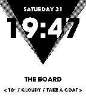
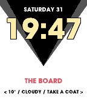
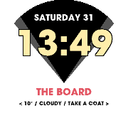
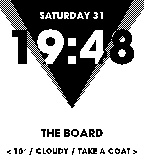
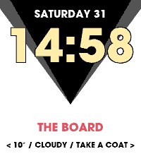
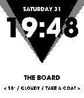

# Take Control

Inspired by the game Control developed by Remedy Entertainment, this simple watchface will accompany you in your daily life with some words from the Board about the weather.
 
On the hour, wrist flick, or back from the menu, the black pyramid will descend in a smooth animation.

## Screenshots









## Store

[Pebble App Store](https://apps.repebble.com/6ae63f62d0da32000934000d)

[Rebble App Store](https://apps.rebble.io/en_US/application/6ae63f62d0da32000934000d)

## Font

`resources/adventor-heavy.otf` is [TeX Gyre Adventor](https://www.gust.org.pl/projects/e-foundry/tex-gyre/adventor) Bold with thicker outlines, under the GUST Font License (`resources/GUST-FONT-LICENSE.txt`). The original is `resources/texgyreadventor-bold.otf`.

```sh
# Change the weight (needs FontForge)
fontforge -lang=py scripts/embolden-font.py resources/texgyreadventor-bold.otf resources/adventor-heavy.otf 22
# Regenerate adventor.ffont, also after changing the characters in the script
npm run font
```